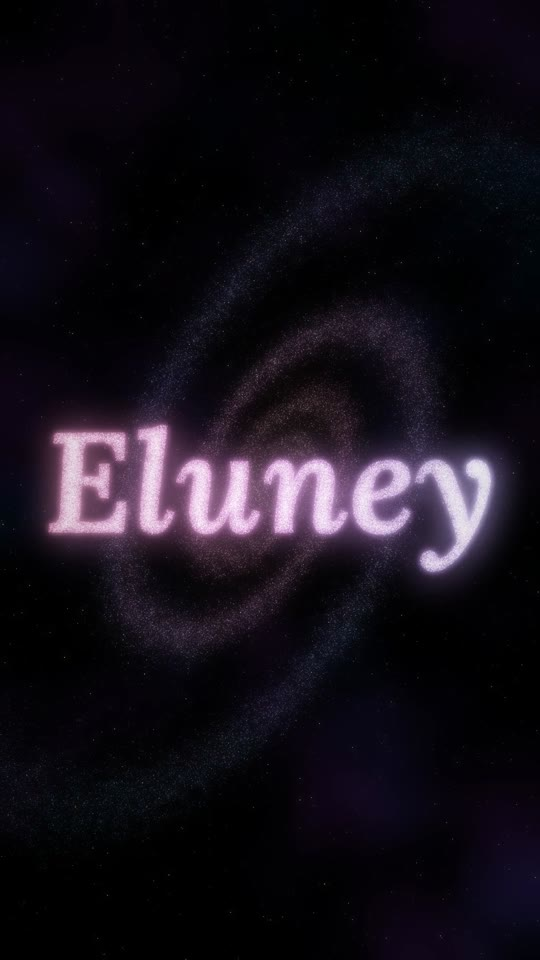

# Animaciones con Python

Animaciones hechas con programación. Cada una es un archivo `.py` que genera
un video MP4 en la carpeta `videos/`, listo para compartir por WhatsApp.

## Animaciones

| Animación | Script | Video |
|---|---|---|
| Galaxia que forma el nombre **Eluney** | [`galaxia_eluney.py`](galaxia_eluney.py) | [`videos/galaxia_eluney.mp4`](videos/galaxia_eluney.mp4) |



## Cómo correrlas en PyCharm

1. Abrí esta carpeta en PyCharm (*File → Open*) y aceptá crear el entorno virtual (`.venv`).
2. Instalá las librerías (PyCharm lo ofrece solo al ver `requirements.txt`, o en la terminal):
   ```
   pip install -r requirements.txt
   ```
3. Abrí el script y apretá **Run**. Mientras se genera el video se ve una vista previa;
   al terminar queda en `videos/`.

Opciones útiles:

```
python galaxia_eluney.py --rapido       # prueba rápida a media resolución
python galaxia_eluney.py --cuadro 14    # guarda solo la imagen del segundo 14
python galaxia_eluney.py --sin-ventana  # sin vista previa
```

Arriba de cada script están las constantes para personalizar: el nombre, la duración,
los colores, la semilla (cambiándola sale otra galaxia), etc.

## Compartir por WhatsApp

Los videos son MP4 H.264 verticales (1080×1920), compatibles con cualquier celular.
Para que llegue con la calidad original, mandalo como **documento**
(📎 → *Documento* → elegir el `.mp4`) en vez de como video, que WhatsApp lo comprime.

## Créditos

Fuente tipográfica: [Lora](https://github.com/cyrealtype/Lora-Cyrillic), licencia
SIL Open Font License 1.1 (ver `fuentes/OFL-Lora.txt`).
